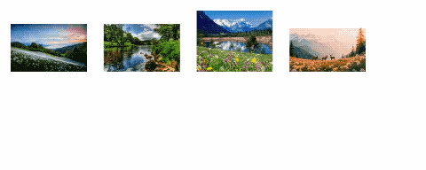

# Школа "Лидер" - Проект Git 1

## Описание
Этот проект представляет собой простую веб-страницу с галереей фотографий природы. Страница сверстана с использованием HTML и CSS.

## Как запустить
1. Скачайте проект.
2. Откройте файл `index.html` в любом современном браузере (Chrome, Firefox, Yandex).

## Демонстрация работы

## Цель
Проект реализован в образовательных целях на онлайн-курсе "Git и Github" в школе программирования "Лидер".
